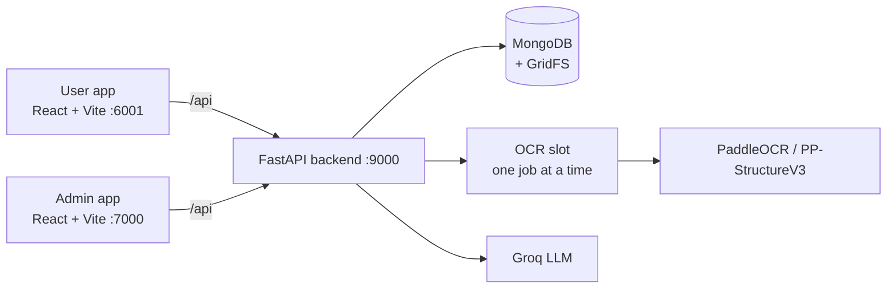

# THE MAIN OCR - Consignor / Consignee Bill OCR

[](https://github.com/prathamthatte52701/OCR-CONSIGNOR-CONSIGNEE-BILL-AI/actions/workflows/ci.yml)

Upload a consignor / consignee bill as two photos or PDFs, let OCR and an LLM read it, check the
result against the original image, correct what is wrong, and download it. Built by team Neural Nexus.

## Contents

1. [What it does](#what-it-does)
2. [Features](#features)
3. [Architecture](#architecture)
4. [Tech stack](#tech-stack)
5. [Folder map](#folder-map)
6. [Quick start](#quick-start)
7. [Configuration](#configuration)
8. [Admin app](#admin-app)
9. [API overview](#api-overview)
10. [Security](#security)
11. [Testing](#testing)
12. [CI](#ci)
13. [Accuracy and known limits](#accuracy-and-known-limits)
14. [Deployment notes](#deployment-notes)
15. [Troubleshooting](#troubleshooting)
16. [Roadmap](#roadmap)
17. [Credits](#credits)

## What it does

A **document** is one bill made of two uploads:

- **Part 1** - the header page: consignee code and name, consignee / consignor GSTIN, PAN, state,
  pincode, addresses, invoice number, date, PO number, IRN, FI doc and similar header fields.
- **Part 2** - the item page: the line-item table (serial no, description, HSN/SAC, basic, quantity,
  amount, reason) and the tax summary (total basic amount, CGST / SGST / IGST, total amount).

The two parts are read by different pipelines, merged into one record, checked by deterministic
rules, and shown on a review page next to the original image. The user fixes anything that is
wrong and the correction is stored.

## Features

**Extraction**
- Part 1: image clean-up (OpenCV), PaddleOCR, column bucketing, then Groq LLM field extraction.
- Part 2: PP-StructureV3 table recognition, an HTML table parser, then Groq for the tax summary.
  Part 2 always gets the raw image (Part 1 clean-up would shift empty cells).
- Deterministic corrections after the LLM (digit / letter confusion, GSTIN, PAN, date, money) in
  `backend/app/features/ocr/extraction.py`. Manual edits use the same rules.
- Per-field confidence; fields below the threshold are flagged for review.
- JPG, PNG and PDF input. A PDF may have up to 4 pages but only page 1 is read.

**Review warnings** (computed when the document is read, nothing extra stored)
- Implausible date.
- Line items do not add up to Total Basic Amount; Total Basic Amount was auto-corrected.
- Total Basic Amount plus taxes does not match Total Amount.
- Document has more than one page (rows on other pages are missing).
- Line item serial numbers: empty, not a number, or out of order (the odd row is pointed out).
- Empty or junk line item descriptions.
- Quantity x basic does not match amount on a row.
- Messages only contain a position and a short reason, never document text.

**Documents**
- Single upload and bulk upload (up to 5 pairs per request), 5 MB per file.
- Live processing status, reprocess, restart recovery for jobs interrupted by a restart.
- List with search (invoice number, consignee code, consignee), month / date / IST range, status
  and needs-review filters, sorting, paging; the URL holds the filters.
- Inline field correction with a stored correction history.
- Download one document's original files, or Download All as a ZIP (max 30 documents, 100 MB).
- Permanent delete, or "delete files" which removes the originals and keeps the extracted data.

**Dashboard and training card**
- Totals, processed / failed, needs review, multi-page, processing now, stored files and size.
- A training card: documents processed and documents you corrected.
- My Activity timeline and a Help page.

**Chat**
- Users talk to the admins from inside the app; admins have an inbox and can clear conversations.
- File attachments in a separate GridFS bucket, capped in total by `CHAT_FILES_MAX_TOTAL_MB`.

**Admin dashboard**
- 14-day upload and failure series, 7-day trends, pending approvals (approve in one click),
  grouped recent activity.

**Security** - see [Security](#security).

## Architecture



In development the two Vite servers proxy `/api` and `/health` to the backend.

**One upload, step by step**

1. The browser sends Part 1 and Part 2 to `POST /api/documents/upload`.
2. The backend checks the login, type, size and image pixel limits, stores both files in GridFS and
   creates the document with status `uploaded`.
3. A background task waits for the single OCR slot and sets the status to `processing`.
4. Part 1 runs through the OpenCV + PaddleOCR + Groq pipeline, Part 2 through PP-StructureV3 + Groq.
5. Deterministic corrections run, confidences are set, review flags are stored.
6. The pipeline writes the result only if the document is still the same run (stale jobs are
   ignored) and sets the status to `processed` (or `failed` with a message).
7. The browser polls the document every few seconds while it is processing.

## Tech stack

| Layer | Technology |
|---|---|
| Backend | Python 3.12, FastAPI 0.139, Motor (async MongoDB), Pydantic 2, slowapi |
| OCR | PaddleOCR 3.7, PP-StructureV3 (PaddleX), OpenCV, Pillow, PyMuPDF (PDF pages) |
| LLM | Groq (default model `openai/gpt-oss-120b`, set with `GROQ_MODEL`) |
| Database | MongoDB with GridFS for files |
| Auth | bcrypt, JWT (PyJWT, HS256) |
| User app | React 19, Vite 8, Tailwind 4, React Router, React Query, Zustand |
| Admin app | React 19, Vite 8, Tailwind 4, React Router |
| Tests | pytest with an in-process fake MongoDB, `node --test` for front-end helpers |
| CI | GitHub Actions |

## Folder map

```
backend/            FastAPI app, tests sit next to the code (test_*.py)
  app/core/         settings, database + indexes, security, rate limits, audit log, validators
  app/features/
    auth/           signup, login, profile, change password, password-reset requests
    admin/          admin-only routes: users, documents, logs, telemetry, maintenance, orphaned files
    documents/      user document routes, list query, review warnings, corrections, downloads
    ocr/            Part 1 and Part 2 pipelines, extraction rules, OCR slot, prompts
    chat/           user <-> admin chat and attachments
  app/scripts/      seed_admin, migrate_user_status
  conftest.py       test safety harness (forces a *_test database, installs the fake Mongo)
  fake_mongo.py     in-process stand-in for Motor / PyMongo / GridFS used by the tests
  testkit.py        test helpers (make_user, make_document, current_db)
frontend/           user app (port 6001)
admin/              admin app (port 7000)
requirements.txt    pinned runtime packages
requirements-dev.txt  adds the dev tools (pytest, ruff, black, isort, mypy)
setup.bat start.bat stop.bat   Windows helper scripts
.github/workflows/ci.yml       CI
CLAUDE.md           detailed architecture notes and rules for contributors
```

## Quick start

Needs Python 3.12, Node.js 20.19+ (or 22.12+) and a MongoDB database you can connect to.

**Windows**

```bat
setup.bat       :: creates the venv, installs backend and both web apps, creates backend\.env if missing
:: open backend\.env and fill in MONGO_URI, GROQ_API_KEYS, JWT_SECRET and the ADMIN_1_* values
cd backend
..\venv\Scripts\python.exe -m app.scripts.seed_admin     :: creates the first admin (once)
cd ..
start.bat       :: starts backend, user app and admin app in three minimized windows
stop.bat        :: stops only what start.bat started
```

`setup.bat` never overwrites an existing `backend\.env` and is safe to run twice.
The first backend start can take a minute while the OCR models load.

| What | URL |
|---|---|
| User app | http://localhost:6001 |
| Admin app | http://localhost:7000 |
| Backend health | http://127.0.0.1:9000/health |
| API docs (only if `ENABLE_DOCS=true`) | http://127.0.0.1:9000/docs |

**Linux / macOS (manual)**

```bash
python3.12 -m venv venv
venv/bin/pip install -r requirements.txt
cp backend/.env.example backend/.env        # then fill in the required values
cd backend
../venv/bin/python -m app.scripts.seed_admin
../venv/bin/python -m uvicorn app.main:app --host 127.0.0.1 --port 9000
# in two more terminals:
cd frontend && npm ci && npm run dev -- --host 127.0.0.1
cd admin && npm ci && npm run dev -- --host 127.0.0.1
```

The `.bat` scripts are only tested on Windows.

## Configuration

Set in `backend/.env` (template: `backend/.env.example`). Never commit `.env`.
Whitespace around values is stripped.

| Name | Meaning | Default | Required |
|---|---|---|---|
| `MONGO_URI` | MongoDB connection string. Blank fails at startup | - | yes |
| `MONGO_DB_NAME` | Database name. Blank uses the default | `docintel_cons_cons` | no |
| `GROQ_API_KEYS` | Groq API key(s), comma separated | - | yes |
| `GROQ_MODEL` | Groq model used for extraction | `openai/gpt-oss-120b` | no |
| `JWT_SECRET` | Token signing secret, at least 32 characters | - | yes |
| `PORT` | Backend port setting | `9000` | no |
| `FRONTEND_ORIGIN` | Allowed CORS origin of the user app. Blank uses the default | `http://localhost:6001` | no |
| `ADMIN_ORIGIN` | Allowed CORS origin of the admin app. Blank uses the default | `http://localhost:7000` | no |
| `NODE_ENV` | `production` turns on HSTS | `development` | no |
| `MODEL_TYPE` | Model type label | `consignor_consignee` | no |
| `ENABLE_DOCS` | `true` serves `/docs`, `/redoc`, `/openapi.json` | `false` | no |
| `RECOVER_INTERRUPTED_UPLOADS` | Re-queue documents left in `processing` by a restart | `true` | no |
| `CHAT_FILES_MAX_TOTAL_MB` | Cap on all stored chat attachments together (1-100000) | `75` | no |
| `ADMIN_1_EMAIL`, `ADMIN_1_USERNAME`, `ADMIN_1_PASSWORD` | First admin, used by `seed_admin` | empty | for `seed_admin` |
| `ADMIN_2_EMAIL`, `ADMIN_2_USERNAME`, `ADMIN_2_PASSWORD` | Second admin, used by `seed_admin` | empty | no |

Test-only variables: `TEST_MONGO_URI` and `TEST_MONGO_DB_NAME` (see [Testing](#testing)) and
`CHECK_INSTALLED_PINS=1`.

If you change the ports, change them in `FRONTEND_ORIGIN` / `ADMIN_ORIGIN`, in the `proxy` target
of `frontend/vite.config.js` and `admin/vite.config.js`, and in `start.bat` / `stop.bat`.

## Admin app

**First admin.** Admins are created from the environment, not from the sign-up form. Fill in the
`ADMIN_1_*` values in `backend/.env`, then from `backend/` run:

```bash
python -m app.scripts.seed_admin
```

The script is idempotent. New users sign up and stay `pending` until an admin approves them.

**What an admin can do** (admin app, port 7000)

- Dashboard: series, trends, pending approvals with Approve, recent activity.
- Users: approve, reject, revoke, edit, change email, force logout, delete, purge old documents.
- Password requests: users ask for help, the admin sets a temporary password.
- Documents of all users: view, download, edit, delete, purge files. Every cross-user access is
  written to the audit log before the data is returned.
- Logs (audit log), Orphaned files (retry or dismiss failed file deletes), Maintenance (bulk delete
  with a typed confirmation and a rate limit).
- Chat inbox with the users.

## API overview

All routes are under `/api` and send camelCase JSON. Auth is a bearer token.

| Group | Routes (examples) |
|---|---|
| `/api/auth` | `POST /signup`, `POST /login`, `GET/PATCH /me`, `GET /me/activity`, `POST /change-password`, `POST /password-reset-request` |
| `/api/documents` | `POST /upload`, `POST /bulk-upload`, `GET /` (list), `GET /{id}`, `PATCH /{id}/correct`, `POST /{id}/reprocess`, `DELETE /{id}`, `POST /{id}/purge-files`, `GET /{id}/download/part1`, `GET /{id}/download/part2`, `POST /download-all`, `GET /stats`, `GET /training-stats`, `GET /storage` |
| `/api/admin` | `/users...`, `/documents...`, `/password-requests...`, `/logs`, `/telemetry`, `/orphaned-files...`, `/nuke-global`, `/purge-months...`, `/system` |
| `/api/chat` | `/admins`, `/threads`, `/messages`, `/messages/file`, `/files/{id}`, `/read`, `/unread`, `/settings`, `/clear`, `/clear-all` |
| `/health` | liveness check, no login |

Every user query is scoped to the logged-in user. A document that is not yours answers 404,
never 403. A malformed id answers 400. The interactive docs are available only when
`ENABLE_DOCS=true`.

## Security

- **Accounts:** sign-up creates a `pending` user; an admin must approve. Login checks the password
  first and only then reveals pending / rejected. The user is re-read from the database on every
  request, so revoking or force-logout takes effect at once.
- **Passwords:** 8-64 bytes, upper and lower case, a digit and a special character, no spaces, not
  a common password, not containing the username or the start of the email. Stored with bcrypt.
- **Tokens:** JWT, HS256 only, 7-day lifetime.
- **Email:** at most 254 characters everywhere. A login with a longer address gets the same
  generic "Invalid email or password." as a wrong one.
- **Rate limits** (per IP, in memory): sign-up 15/hour, login 100 per 15 minutes plus a per-email
  login limiter, password-reset request 10/hour plus a per-email limiter, uploads 120/hour, bulk
  uploads 30/hour. Chat clear-all allows 5 wrong passwords per hour; a right password does not
  count. Counters reset when the backend restarts.
- **Uploads:** 5 MB per file, bulk at most 5 pairs, file type checked by content, image pixel
  limits, filenames sanitised before they reach a header or a ZIP entry.
- **Headers:** `X-Content-Type-Options: nosniff`, `X-Frame-Options: DENY`, a Content-Security-Policy,
  a referrer policy, and HSTS when `NODE_ENV=production`. The chat file route keeps its own stricter
  `default-src 'none'; sandbox`.
- **Other:** `/docs` is off unless enabled, validation errors never echo the input, the admin
  nuke routes are rate limited and audited.

### Running behind a proxy

Rate limits are keyed on the connecting IP. Behind a reverse proxy every user would look like the
proxy's address, so let uvicorn rewrite the client address itself, for the trusted proxy only:

```bash
uvicorn app.main:app --host 127.0.0.1 --port 9000 --proxy-headers --forwarded-allow-ips="10.0.0.5"
```

Set `--forwarded-allow-ips` to the proxy's address (comma separated for several), **never `*`**:
with `*` anyone can send a forged `X-Forwarded-For` header and pick their own rate-limit key.
The app never reads `X-Forwarded-For` on its own; a header that no trusted proxy rewrote is
ignored (covered by `backend/app/core/test_rate_limit_key.py`).

## Testing

Backend, from `backend/` with the repo `venv`:

```bash
pytest                                   # everything (about 1250 tests)
pytest app/core app/features/documents   # some folders
pytest app/features/ocr/test_extraction.py::test_name
ruff check . && black --check . && isort --check . && mypy .
```

- The suite collects **1252** tests (`pytest --collect-only -q`).
- Tests never touch a real database. `conftest.py` forces a database name ending in `_test` and
  aborts otherwise, and installs `fake_mongo.py`, an in-process stand-in for Motor, PyMongo and
  GridFS. To run against a real server set `TEST_MONGO_URI` to a local `*_test` database only.
- `CHECK_INSTALLED_PINS=1` also checks that the installed packages match `requirements.txt`.
- Core tests cover indexes, requirements pins, safe defaults, config, security headers, the
  conftest guard, validators and the rate-limit key.

User app and admin app, from their folder:

```bash
npm run lint
npm run build
node --test $(find src -name "*.test.js")    # 10 tests in frontend/, 17 in admin/
```

## CI

`.github/workflows/ci.yml` runs on every push and pull request to `main`:

- **backend-lint:** `ruff check backend/app` and `black --check backend/app`.
- **backend-tests:** installs `requirements-dev.txt`, then runs `pytest` on `app/core` and the
  `auth`, `admin`, `chat`, `documents` and `ocr` feature folders with `CHECK_INSTALLED_PINS=1`,
  a fake JWT secret, and the fake Mongo.
- **frontend** and **admin:** `npm ci`, `npm run lint`, `npm run build`, `node --test`.

The workflow uses no secrets and has read-only permissions.

## Accuracy and known limits

Measured on **2026-11-08** on a local test set of **59 document pairs** (3,368 scored cells),
each pair uploaded one by one through the real routes and compared with values read twice from
the images by hand. Only printed text counts; handwriting and stamps are not scored. The numbers
come from one run of that set and are not a promise for other documents.

| Measure | Result |
|---|---|
| All cells (lenient description) | 91.06% (92.46% when only cells with certain reference values are counted) |
| All cells (strict description) | 86.28% |
| Part 1 header fields | 97.96% |
| Part 2 totals and tax | 99.15% |
| Part 2 line-item cells (lenient description) | 83.27% |
| Part 2 line-item cells (strict description) | 73.33% |
| Description (lenient: spaces, case, punctuation and a dropped diameter sign are forgiven) | 61.48% |
| Description (strict: exactly the same text) | 1.85% (5 of 270) |
| Failed uploads, OCR errors, timeouts | 0 in 79 runs (59 single + 20 bulk) |
| Time per document | 101.5 s on average (one pair at a time, CPU) |

The overall 91.06% and the line-item 83.27% use the lenient description score. With the strict
description score they are 86.28% and 73.33%. The strict numbers change only the description
cells; every other field is scored the same way in both. Descriptions are very rarely copied
exactly: OCR usually drops spaces or the diameter sign, so read the lenient 61.48% as "close to
the printed text", not as "correct".

Weakest fields (lenient): description 61.48%, serial number (`srNo`) 68.89%, reason 75.86%, HSN/SAC
88.52%, amount 92.59%, quantity 92.96%. Twenty fields were read correctly in every document
(for example consignee code, GSTIN, PAN, state, pincode, challan date, total amount).

Be aware of the following:

- Line items are the weak part. The serial-number column is faint on many photos and is often
  read as empty or as a wrong character; descriptions lose characters such as the diameter sign
  or get handwriting appended.
- In that run the review warnings flagged 13 documents and all 13 had a real error, but 49
  documents contained an error, so about a quarter were flagged. The serial-number, description
  and row-amount warnings listed under Features were added after that run and are not part of
  these numbers.
- 20 of the pairs were also sent as a bulk upload; the result matched the one-by-one result for
  19 of 20 documents.
- OCR runs one document at a time; bulk upload mostly saves clicks, not time.
- The reference values have a small error of their own (3.5% of cells were uncertain between the
  two readings).

Other limits: only page 1 of a PDF is read; the rate limits live in memory; Groq is an outside
service and a document fails if it cannot be reached.

## Deployment notes

- **Backend:** run uvicorn behind a reverse proxy with `--proxy-headers` and a specific
  `--forwarded-allow-ips` (see above). Set `NODE_ENV=production`, a long random `JWT_SECRET`,
  real `FRONTEND_ORIGIN` / `ADMIN_ORIGIN`, and leave `ENABLE_DOCS` off. Use one backend process:
  rate-limit counters and the OCR slot are per process.
- **Web apps:** `npm run build` in `frontend/` and `admin/` produces a static `dist/` folder.
  Serve it from any static host and route `/api` to the backend. The backend's security headers
  only cover API responses, so set `X-Content-Type-Options: nosniff`, `X-Frame-Options: DENY`, a
  Content-Security-Policy and a referrer policy on the static host yourself.
- **Secrets:** put them in the host's environment or secret store. Never commit `.env`.
- **MongoDB:** the app creates its indexes at startup.

## Troubleshooting

| Problem | What to check |
|---|---|
| Backend exits at startup with `invalid configuration` | `MONGO_URI` is blank or missing, `JWT_SECRET` is shorter than 32 characters, or `GROQ_API_KEYS` is missing. Fix `backend/.env`. |
| `start.bat` says a port is already used | Something else uses 9000, 6001 or 7000. Close it, or run `stop.bat` if it is a leftover of this app. |
| `start.bat` says the app is only partly running | Run `stop.bat`, then `start.bat`. |
| First start is slow | The OCR models load on first use. Wait for `http://127.0.0.1:9000/health`. |
| `pip install` is slow or fails on PaddlePaddle | The OCR packages are large. Use Python 3.12 and a 64-bit Python. |
| Login says "Invalid email or password." for a very long email | Emails longer than 254 characters are always refused with that message. |
| Login says the account is pending or rejected | An admin has to approve the account in the admin app. |
| 429 Too many requests | A rate limit was hit; wait and retry. Limits reset when the backend restarts. |
| Browser CORS error | `FRONTEND_ORIGIN` / `ADMIN_ORIGIN` must match the address in the browser bar exactly. |
| Document stays in `processing` | Restart the backend; with `RECOVER_INTERRUPTED_UPLOADS=true` it is re-queued. Or use Reprocess. |
| Tests refuse to run | The database name must end in `_test`; do not point tests at a real database. |

## Roadmap

Left open on purpose:

- Google sign-in (skipped).
- Reading more than page 1 of a multi-page document (skipped).
- Excel export of extracted data (dropped).
- Better line-item reading (serial numbers and descriptions), the largest source of errors today.

## Credits

Built by team Neural Nexus. No license file is included in this repository yet; ask the
maintainers before reusing the code.
